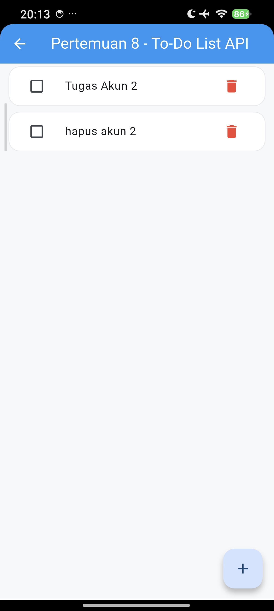
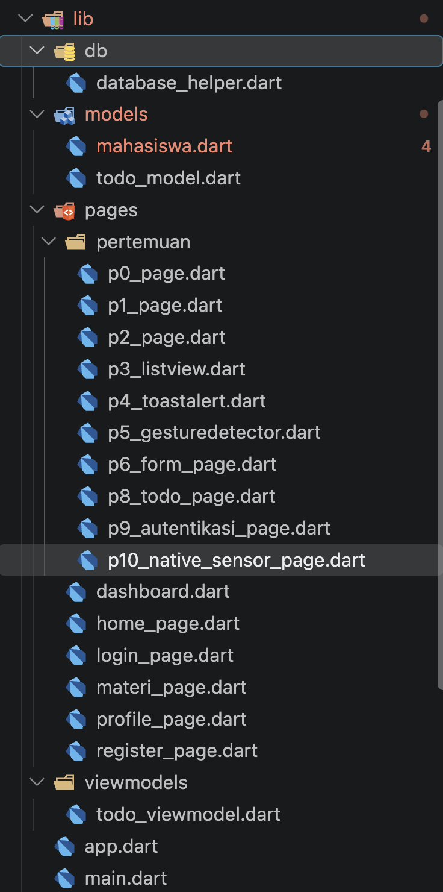

# Pertemuan 11 — Implementasi Arsitektur MVVM

Nama: Agus Dwijayanto
NIM: 241011750001
Kelas: 04SIFE002

## 1. Cara menerapkan MVVM

Di pertemuan ini saya menerapkan MVVM di fitur To-Do List (Pertemuan 8).
Kodenya saya pisah jadi tiga bagian:

- Model (`lib/models/todo_model.dart`): isinya data Todo, yaitu id, judul,
  selesai, dan user_id. Ada `fromJson` dan `toJson`.
- ViewModel (`lib/viewmodels/todo_viewmodel.dart`): isinya state dan logika.
  State-nya daftar tugas, sedang memuat, dan pesan error. Logikanya muat
  tugas, tambah tugas, ubah status, dan hapus tugas. Buat ambil data dari
  Supabase saya pakai header apikey dan token Bearer dari sesi login, plus
  user_id.
- View (`lib/pages/pertemuan/p8_todo_page.dart`): isinya tampilan saja. Kalau
  pengguna menekan tombol, View teruskan ke ViewModel. Kalau ada perubahan,
  View ikut berubah karena mendengarkan ViewModel lewat `ListenableBuilder`.
  Route `/p8` dan kartu Materi tidak saya ubah.

Cara kerjanya: View minta data ke ViewModel, ViewModel ambil data dari
Supabase, terus View ikut berubah. Saya tidak menambah package baru.

## 2. Contoh implementasi

Model:

```dart
class Todo {
  final int id;
  final String judul;
  final bool selesai;
  final String userId;

  factory Todo.fromJson(Map<String, dynamic> json) {
    return Todo(
      id: json['id'] is int ? json['id'] : int.parse(json['id'].toString()),
      judul: json['judul'] ?? '',
      selesai: json['selesai'] == true,
      userId: json['user_id'] ?? '',
    );
  }
}
```

ViewModel:

```dart
class TodoViewModel extends ChangeNotifier {
  List<Todo> _daftarTugas = [];
  bool _sedangMuat = true;
  String? _pesanError;

  final TextEditingController judulController = TextEditingController();

  Future<void> ambilTugas() async {
    final response = await http.get(
      Uri.parse('$supabaseUrl/rest/v1/todos?select=*&order=id.asc'),
      headers: _header(),
    );
    if (response.statusCode == 200) {
      final List<dynamic> decoded = jsonDecode(response.body);
      _daftarTugas = decoded.map((item) => Todo.fromJson(item)).toList();
      _sedangMuat = false;
    }
    notifyListeners();
  }
}
```

View:

```dart
class _P8TodoPageState extends State<P8TodoPage> {
  late final TodoViewModel _viewModel;

  @override
  void initState() {
    super.initState();
    _viewModel = TodoViewModel();
    _viewModel.ambilTugas();
  }

  @override
  Widget build(BuildContext context) {
    return ListenableBuilder(
      listenable: _viewModel,
      builder: (context, _) {
        return Scaffold(
          appBar: AppBar(title: const Text('Pertemuan 8 - To-Do List API')),
          body: _isiBody(),
        );
      },
    );
  }
}
```

## 3. Hasil

Sesudah di-refactor, halaman To-Do tetap jalan seperti biasa. Tugas tampil,
tombol tambah, centang, dan hapus berfungsi.



Ini struktur file-nya, sudah kepisah jadi tiga bagian (models, viewmodels,
halaman P8):



Saya tes di HP Poco F6: login, tambah, centang, hapus, dan logout jalan. Dua
akun tetap hanya melihat tugas masing-masing, sama seperti sebelum di-refactor.
