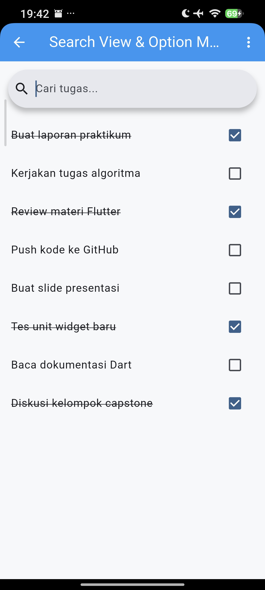
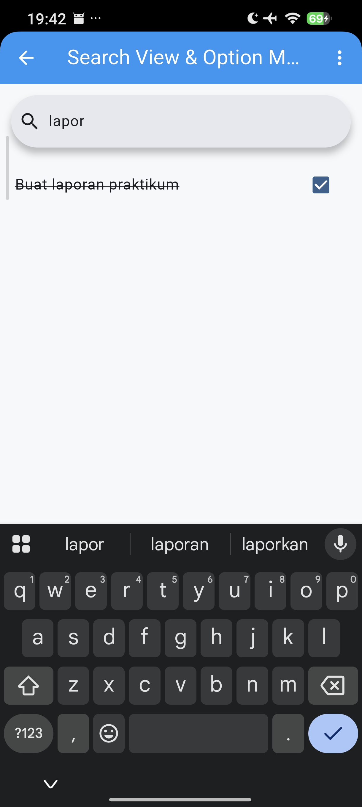
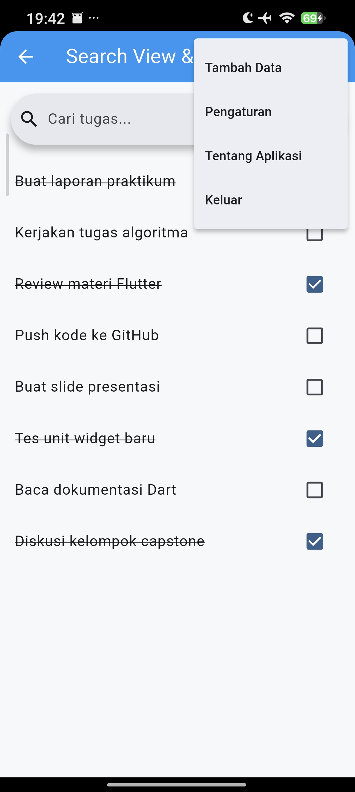
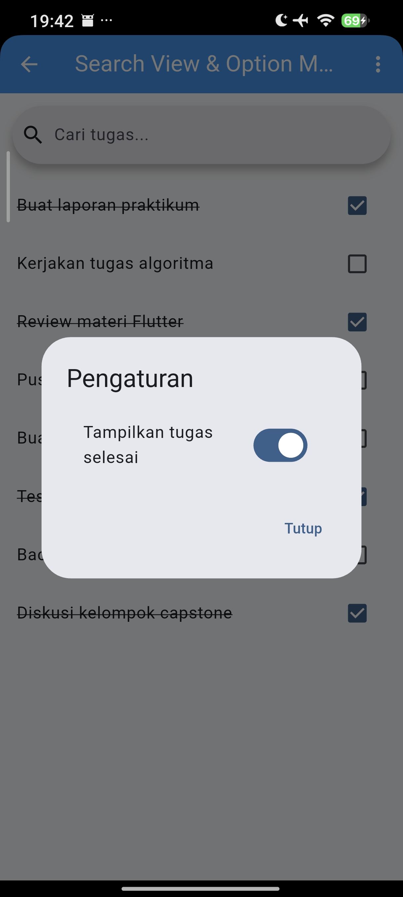
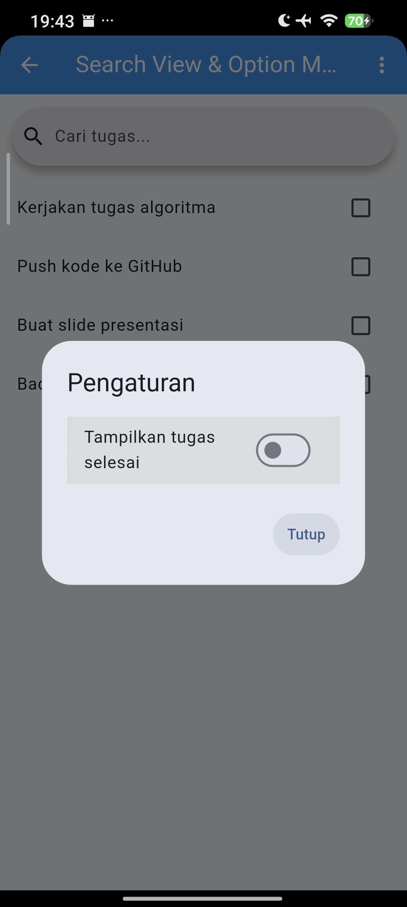
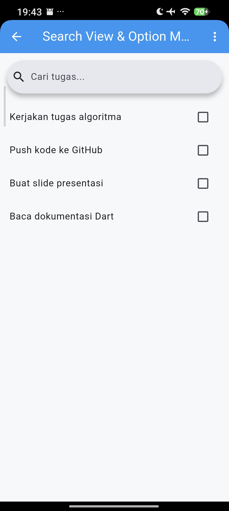

# Pertemuan 12 — Search View dan Option Menu

Nama: Agus Dwijayanto
NIM: 241011750001
Kelas: 04SIFE002

## 1. Search View dan Option Menu itu apa

Search View adalah fitur pencarian di layar. Pengguna mengetik kata kunci,
daftar langsung berubah sesuai yang dicari. Di contoh ini saya pakai widget
SearchBar. Setiap huruf yang diketik memfilter daftar tugas lewat onChanged.
Pencocokannya mengabaikan huruf besar dan kecil, jadi ketik "lapor" tetap
ketemu "Buat laporan praktikum".

Option Menu adalah daftar pilihan aksi yang muncul saat ikon titik tiga di
AppBar ditekan. Saya pakai widget PopupMenuButton. Ada empat pilihan: Tambah
Data, Pengaturan, Tentang Aplikasi, dan Keluar. Masing-masing membuka dialog
sesuai fungsinya. Contohnya Pengaturan berisi saklar untuk menampilkan atau
menyembunyikan tugas yang sudah selesai.

Dua fitur ini bikin aplikasi lebih mudah dipakai. Pengguna tidak perlu
menggulir daftar panjang untuk mencari satu tugas, dan aksi-aksi yang jarang
dipakai tidak memenuhi layar.

## 2. Contoh implementasi

Satu halaman baru, `lib/pages/pertemuan/p12_search_menu_page.dart`, route
`/p12`, kartu Materi "Pertemuan 12". Datanya daftar tugas lokal di dalam
halaman, bukan dari Supabase. Saya tidak menambah package baru.

SearchBar dan filter:

```dart
SearchBar(
  controller: _searchController,
  hintText: 'Cari tugas...',
  leading: const Icon(Icons.search),
  onChanged: (val) => setState(() => _query = val),
),
```

```dart
List<Map<String, dynamic>> get _filtered {
  return _daftarTugas.where((t) {
    final cocok = t['nama'].toString().toLowerCase().contains(_query.toLowerCase());
    final tampil = _tampilkanSelesai ? true : !(t['selesai'] as bool);
    return cocok && tampil;
  }).toList();
}
```

Option Menu:

```dart
PopupMenuButton<String>(
  onSelected: (val) {
    switch (val) {
      case 'tambah':
        _dialogTambah();
      case 'pengaturan':
        _dialogPengaturan();
      case 'tentang':
        showAboutDialog(
          context: context,
          applicationName: 'Praktikum MP',
          applicationVersion: '1.0.0',
          applicationLegalese: '© 2026 Praktikum Mobile Programming',
        );
      case 'keluar':
        _dialogKeluar();
    }
  },
  itemBuilder: (_) => const [
    PopupMenuItem(value: 'tambah', child: Text('Tambah Data')),
    PopupMenuItem(value: 'pengaturan', child: Text('Pengaturan')),
    PopupMenuItem(value: 'tentang', child: Text('Tentang Aplikasi')),
    PopupMenuItem(value: 'keluar', child: Text('Keluar')),
  ],
)
```

## 3. Hasil

Halaman P12 menampilkan 8 tugas contoh. Tugas yang sudah selesai tercoret
dan tercentang:



Saya ketik "lapor" huruf kecil, daftar langsung menyaring jadi satu tugas
saja:



Menu titik tiga menampilkan empat pilihan:



Dialog Pengaturan berisi saklar "Tampilkan tugas selesai". Waktu saklar
menyala, semua tugas tampil:



Waktu saklar dimatikan, tugas yang sudah selesai langsung hilang dari
daftar:



Sesudah dialog ditutup, daftar tetap hanya menampilkan tugas yang belum
selesai:



Saya tes di HP Poco F6: pencarian, centang, menu, dan saklar pengaturan
jalan.
